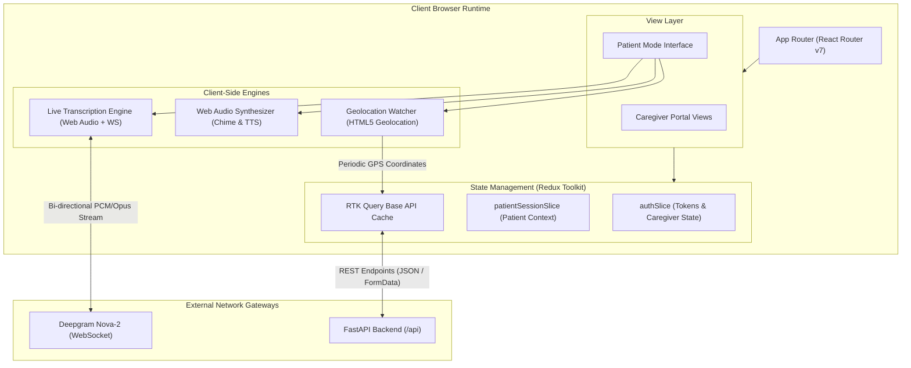
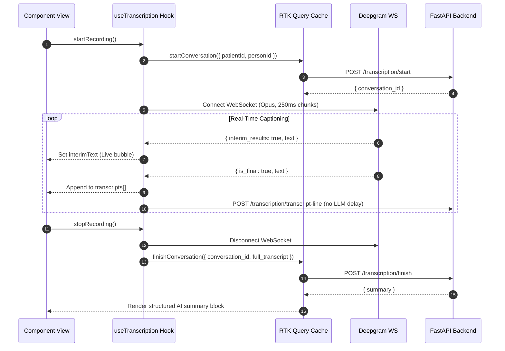

# 🖥️ MemoryBridge — Frontend Application

<div align="center">

**Modern, Accessible, and Empathetic Web Interface for Dementia Care**

[](https://react.dev)
[](https://www.typescriptlang.org)
[](https://vitejs.dev)
[](https://tailwindcss.com)
[](https://redux-toolkit.js.org)

</div>

---

## 📖 Table of Contents
1. [Overview](#-overview)
2. [Frontend Architecture](#-frontend-architecture)
   - [Architectural Topology](#architectural-topology)
   - [State Management & Data Flow](#state-management--data-flow)
3. [Key Modules & User Interfaces](#-key-modules--user-interfaces)
   - [1. Patient Mode (The Cognitive Prosthetic)](#1-patient-mode-the-cognitive-prosthetic)
   - [2. Live Speech Streaming Engine (`useTranscription.ts`)](#2-live-speech-streaming-engine-usetranscriptionts)
   - [3. Stop-Triggered Post-Conversation Summary Block](#3-stop-triggered-post-conversation-summary-block)
   - [4. Routine & Medication Audio Alerts (`RoutineReminderAlert.tsx`)](#4-routine--medication-audio-alerts-routinereminderalerttsx)
   - [5. Daily Routine Schedule Popover (`PatientDailyScheduleCard.tsx`)](#5-daily-routine-schedule-popover-patientdailyschedulecardtsx)
   - [6. Geofencing & GPS Map (`PatientTrackingMap.tsx`)](#6-geofencing--gps-map-patienttrackingmaptsx)
   - [7. Caregiver Administration Portal](#7-caregiver-administration-portal)
4. [Directory Structure](#-directory-structure)
5. [Route Hierarchy & Access Guards](#-route-hierarchy--access-guards)
6. [Component & Styling Conventions](#-component--styling-conventions)
7. [Environment Configuration](#-environment-configuration)
8. [Installation & Development Scripts](#-installation--development-scripts)
9. [Build & Optimization](#-build--optimization)

---

## 🎯 Overview

The **MemoryBridge Client** provides a dual-experience interface built with **React 19**, **TypeScript**, and **Tailwind CSS v4**:
1. **Caregiver Portal**: A comprehensive clinical dashboard for managing patient profiles, enrolling family contacts with facial photographs, designing 24-hour routine and medication schedules, monitoring GPS breadcrumbs on Leaflet maps, and reviewing visit histories.
2. **Patient Mode**: A distraction-free, high-legibility ambient kiosk designed to sit bedside or on a living room tablet. It discreetly recognizes visitors, captions conversations in real time, provides auditory medication reminders, and summarizes interactions without cognitive overload.

---

## 🏛️ Frontend Architecture

### Architectural Topology



---

### State Management & Data Flow

MemoryBridge utilizes **Redux Toolkit (RTK)** and **RTK Query** for deterministic state handling and intelligent caching:

- **`authSlice`**: Stores caregiver JWT access token, refresh token, and user profile in memory and `localStorage`. Handles automatic session recovery upon page refresh.
- **`patientSessionSlice`**: Stores the active patient session context (`patientId`, `patientName`, session token) for running Patient Mode securely without exposing caregiver credentials.
- **`api.ts` (RTK Query)**: Central API definition with automated token refreshing, network error interceptors, and strict cache tag invalidation:
  - `User`, `Patient`, `Person`, `Recognition`, `Conversation`, `Location`, `Routine`.



---

## 🌟 Key Modules & User Interfaces

### 1. Patient Mode (The Cognitive Prosthetic)
- **Visual Face Scanner**: Houses a full-height camera viewport with a subtle, futuristic visual guide box.
- **Countdown Capture**: Triggers a 3-second animated countdown before capturing a high-definition frame to send to `/recognition/match`.
- **Identity Banner**: When recognised, displays the visitor’s relation and name (e.g. `Son · Himanshu`) with high contrast for dementia-friendly readability.
- **Past Visits Drawer**: Lets the patient or caregiver toggle historical visit notes and previous conversation summaries on demand.

### 2. Live Speech Streaming Engine (`useTranscription.ts`)
- **Native Browser WebSocket**: Bypasses proxy overhead by connecting directly from the client to `wss://api.deepgram.com/v1/listen`.
- **Audio Configuration**:
  - Model: `nova-2`
  - Language: `en-US`
  - Punctuation & Smart Formatting: Enabled
  - Audio Chunk Size: 250 milliseconds
  - Codec: `audio/webm;codecs=opus`
- **Interim Speech Streaming**: Streams tentative syllables with `interim_results: true` into `interimText`, rendering a smooth live speech bubble as words are spoken.

### 3. Stop-Triggered Post-Conversation Summary Block
- **Clean Recording Experience**: While recording, no premature summaries or loading skeletons clutter the UI. All vertical space is dedicated to the conversation transcript.
- **Post-Stop Generation**: Clicking **Stop** halts the audio recorder, submits the accumulated transcript to `/transcription/finish`, and displays an animated status (`Summarizing conversation…`).
- **Structured Rendering**: Displays the completed clinical summary in a clean, high-contrast container with emoji-categorized bullet points.

### 4. Routine & Medication Audio Alerts (`RoutineReminderAlert.tsx`)
- **Time Check Loop**: Evaluates patient routines every 20 seconds against the local device clock (`HH:MM`).
- **Web Audio Dual-Tone Chime**: Implemented in [`src/utils/audioAlert.ts`](file:///c:/Users/Kumar%20Abhishek/OneDrive/Desktop/MemoryBridge/client/src/utils/audioAlert.ts) using native Web Audio API oscillators:
  - Note 1: `D5` (587.33 Hz) with smooth gain ramp.
  - Note 2: `A5` (880.00 Hz) sustained chime.
  - Requires zero external audio files and works offline.
- **Speech Synthesis**: Announces the reminder audibly via `window.speechSynthesis` (e.g., *"Reminder: Time to take Morning Blood Pressure Medication"*).
- **Accessible Action Modal**: Presents an overlay with clear category badges (`Medication`, `Meal`, `Appointment`) and a single large **Mark as Done** button.

### 5. Daily Routine Schedule Popover (`PatientDailyScheduleCard.tsx`)
- Located in the top header navigation bar (`PatientDailyScheduleHeaderButton`).
- Allows patients and visiting caregivers to quickly check the entire day's agenda without navigating away from the active camera screen.
- Displays completed items with green checkmarks and shows a visual progress indicator.

### 6. Geofencing & GPS Map (`PatientTrackingMap.tsx`)
- **Geolocation Watcher**: Continuously tracks GPS latitude, longitude, and velocity using `navigator.geolocation.watchPosition`.
- **Leaflet Map Integration**:
  - Renders the patient's home location with a blue center marker.
  - Renders a safety boundary circle reflecting `safe_radius_meters`.
  - Displays a red pulsing marker and warning banner if `is_breached` is detected.
  - Plots chronological GPS breadcrumbs connected by a directional path polyline.

### 7. Caregiver Administration Portal
- **Patients Page**: Card grid of all patients under caregiver management, showing diagnosis severity, age, and quick access links.
- **Patient Detail Page**: Central command center containing:
  - Patient personal metadata and notes
  - Routine & Medication manager (`RoutineScheduleSection.tsx`)
  - Geofence coordinate editor and map tracker
  - "Launch Patient Mode" button that spawns a secure session
- **Face Recognition Hub (`RecognitionPage.tsx`)**:
  - Live webcam snapshot or local file upload
  - Contact details (Name, Relationship, Family Member toggle)
  - Enrolled face gallery with deletion capability

---

## 📂 Directory Structure

```text
client/src/
├── assets/                          # Static branding images and SVGs
├── components/                      # Modular UI components
│   ├── guards/                      # Route protection wrappers
│   │   ├── GuestRoute.tsx           # Redirects authenticated users to dashboard
│   │   ├── PatientModeGuard.tsx     # Validates active patient session
│   │   └── ProtectedRoute.tsx       # Enforces caregiver JWT login
│   ├── layout/
│   │   └── AppNavbar.tsx            # Main caregiver navigation bar
│   ├── ui/                          # Tailwind + Radix UI atomic primitives
│   │   ├── badge.tsx
│   │   ├── button.tsx
│   │   ├── card.tsx
│   │   ├── checkbox.tsx
│   │   ├── form-field.tsx
│   │   ├── input.tsx
│   │   └── label.tsx
│   ├── PatientDailyScheduleCard.tsx # Daily routine popover button
│   └── RoutineReminderAlert.tsx     # Audio chime & voice routine reminder modal
├── hooks/
│   └── useTranscription.ts          # Deepgram streaming STT & summary manager
├── layouts/
│   ├── AuthLayout.tsx               # Centered card layout for login/register
│   ├── PatientModeLayout.tsx        # Fullscreen high-legibility ambient layout
│   └── RootLayout.tsx               # Authenticated caregiver layout with navbar
├── lib/
│   └── utils.ts                     # Tailwind class merge helper (cn)
├── pages/
│   ├── auth/
│   │   ├── LoginPage.tsx            # Caregiver login form
│   │   └── RegisterPage.tsx         # Caregiver account creation
│   ├── patient-mode/
│   │   ├── PatientHistoryPage.tsx   # Comprehensive conversation history
│   │   ├── PatientModePage.tsx      # Core patient camera + conversation view
│   │   └── PatientRecognitionPage.tsx # Standalone face verification test page
│   ├── patients/
│   │   ├── PatientDetailPage.tsx    # Patient profile, routines & geofence manager
│   │   ├── PatientsPage.tsx         # Patient list & creation modal
│   │   ├── PatientTrackingMap.tsx   # Leaflet GPS map with safety boundary circle
│   │   └── RoutineScheduleSection.tsx # Caregiver routine CRUD table
│   ├── recognition/
│   │   ├── RecognitionHubPage.tsx   # Caregiver face management directory
│   │   └── RecognitionPage.tsx      # Contact enrollment & photo upload
│   ├── DashboardPage.tsx            # Caregiver dashboard overview
│   └── NotFoundPage.tsx             # 404 fallback page
├── schemas/
│   └── auth.schema.ts               # Zod validation schemas for authentication
├── services/                        # RTK Query service slices
│   ├── api.ts                       # Base API slice with auto-token refresh
│   ├── patientApi.ts                # Patient CRUD & routine endpoints
│   ├── patientSessionApi.ts         # Scoped session token requests
│   ├── recognitionApi.ts            # Face enrollment & matching mutations
│   ├── socket.ts                    # Optional client Socket.IO connector
│   ├── transcriptionApi.ts          # Start, line, finish & history queries
│   └── userApi.ts                   # Caregiver profile requests
├── store/                           # Redux Toolkit store setup
│   ├── authSlice.ts                 # JWT tokens & caregiver state
│   ├── patientSessionSlice.ts       # Active patient session persistence
│   └── store.ts                     # Root store configuration
├── types/                           # Strongly-typed TypeScript definitions
│   ├── auth.ts                      # Credentials & token responses
│   ├── conversation.types.ts        # Transcripts, summaries & visit records
│   ├── location.types.ts            # GPS pings & breadcrumb structures
│   ├── patient.types.ts             # Patient profiles & diagnosis levels
│   ├── recognition.types.ts         # Biometric match results & enrolled persons
│   └── routine.types.ts             # Daily schedule items & reminder categories
├── utils/
│   └── audioAlert.ts                # Web Audio API dual-tone chime generator
├── routes.tsx                       # React Router v7 configuration
├── main.tsx                         # React 19 bootstrap entrypoint
└── index.css                        # Tailwind v4 import & custom CSS theme tokens
```

---

## 🛡️ Route Hierarchy & Access Guards

```text
/ ─── (Redirects to /dashboard or /login)

├── [GuestRoute] (Accessible only when logged out)
│   ├── /login                       # Caregiver Login
│   └── /register                    # Caregiver Registration
│
├── [ProtectedRoute] (Requires valid Caregiver JWT)
│   ├── /dashboard                   # Caregiver Overview
│   ├── /patients                    # Patient Directory
│   ├── /patients/:id                # Patient Command Center
│   ├── /recognition                 # Face Enrollment Hub
│   └── /recognition/:patientId      # Patient Contact Directory
│
└── [PatientModeGuard] (Requires active Patient Session)
    ├── /patient-mode                # Core Ambient Face & Conversation Kiosk
    └── /patient-mode/history        # Past Visits & Memories Explorer
```

---

## 🎨 Component & Styling Conventions

- **Tailwind CSS v4**: Uses modern CSS variables and color palettes (`@theme` definitions).
- **Apple / Linear Minimalist Aesthetic**:
  - Clean typographic hierarchy with Inter variable font (`@fontsource-variable/inter`).
  - Subtle borders (`border-border/60`), muted backgrounds (`bg-muted/30`), and soft pill badges.
  - Strict absence of gaudy neon banners or cluttered AI badges.
- **Accessibility for Seniors**:
  - High contrast typography for primary text (`text-foreground`).
  - Generous clickable button targets (`h-10`, `rounded-xl`).
  - Clear visual feedback states (pulse indicators for active recording and camera).

---

## ⚙️ Environment Configuration

Create a `.env` file in the `client/` root directory:

```env
# URL where your FastAPI backend is running
VITE_API_BASE_URL=http://localhost:8000

# Deepgram API key with streaming permissions
VITE_DEEPGRAM_API_KEY=your_deepgram_api_key_here
```

> **Security Note**: Never commit actual API keys to source control. In production environments, client environment variables should be injected via CI/CD build pipelines.

---

## 🚀 Installation & Development Scripts

### Install Dependencies
```bash
cd client
pnpm install
```

### Launch Development Server
```bash
pnpm dev
```
The application will launch with Hot Module Replacement (HMR) at `http://localhost:5173`.

### Lint Codebase
```bash
pnpm lint
```

---

## 📦 Build & Optimization

To compile a production-ready client bundle:

```bash
pnpm build
```

This runs `tsc -b` (TypeScript strict type check) followed by `vite build`. The optimized static output will be located in the `client/dist/` directory, ready to be served via Nginx, Vercel, Netlify, or Docker.

To test the production build locally:
```bash
pnpm preview
```
